<div align="center">

# 🌫️ SmogPrint

### Twelve chemicals. No labels. No map. *It found the sources anyway.*

**India's air monitors report numbers, not causes. Give a model only those numbers, and it finds the hidden sources behind them.**<br>
Factor analysis, Gaussian mixtures and hierarchical clustering, written from scratch in NumPy, then tested against events they never saw.


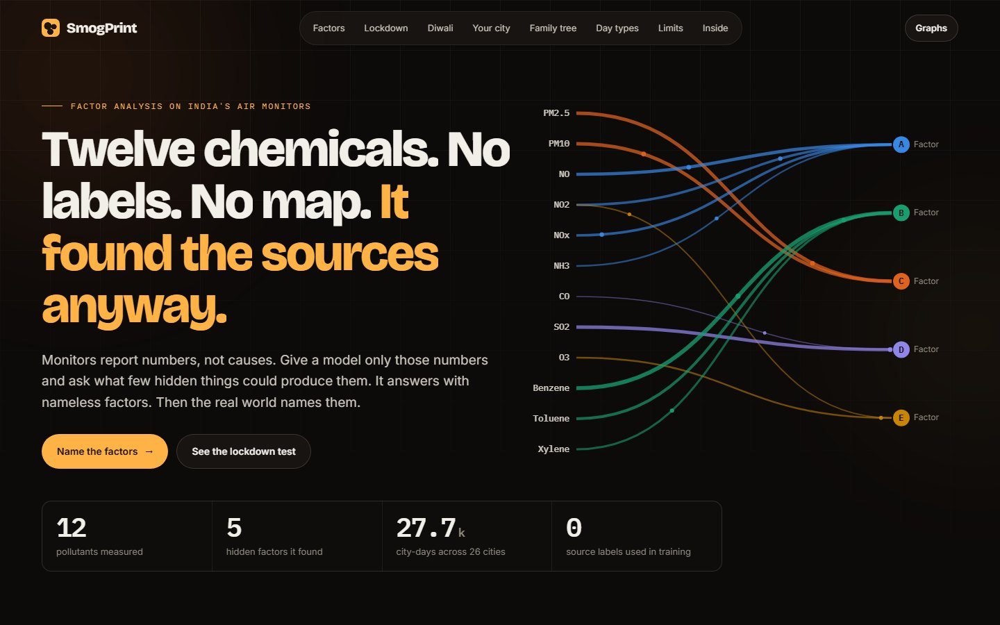

**Live demo:** [https://smogprint.vercel.app](https://smogprint.vercel.app)<br>
[The idea](#idea) · [The five factors](#factors) · [The tests](#tests) · [How it works](#how) · [Models](#models) · [What it cannot claim](#limits) · [Screenshots](#screenshots) · [Run it](#run)

</div>

---

## 📌 At a glance

| 🧪 Pollutants | 🔎 Hidden factors found | 🏷️ Source labels used | 🏙️ City-days | 🧮 Models | 📊 Graphs explained |
|:---:|:---:|:---:|:---:|:---:|:---:|
| **12** | **5** | **0** | **27,663** | **6** | **47** |

---

<a id="idea"></a>
## 💡 The idea

AQI gives a city one number. It tells you the air is bad, not *why*, and "why" decides what would actually help: a traffic rule does little for a coal problem.

Finding sources properly takes a dedicated study that captures particles and analyses their chemistry. Those studies are slow, and
[even they disagree with each other](https://indiaspend.com/how-to-pinpoint-delhis-air-pollution-sources-45985). Meanwhile, monitors across India
already report twelve pollutants every day. So SmogPrint asks:

> If a few hidden sources produce all twelve numbers, can we find those sources from the numbers alone?

That is **factor analysis**. The model gets pollutant readings from before 2020. No source labels. No city names or locations. It returns five nameless factors.
**Then we try to name them using evidence the model never saw.**

Who could use this:

| | Who | What they get |
|:---:|---|---|
| 🏙️ | A resident | What sits behind their city's AQI, and which other city's air is most like it |
| 🏛️ | A city planner | A cheap first look at which sources stand out, before paying for a full study |
| 🌍 | A researcher | A label-free screen across many cities from data that already exists |

---

<a id="factors"></a>
## 🔬 The five factors

The letters are the model's only output. The names are **our reading** of the evidence.

| Factor | Loads on | Our reading | Why we think so |
|:---:|---|---|---|
| **A** | NO, NOx, NO₂, NH₃ | **Traffic and combustion** | Lowest at 14:00, highest at 21:00. Sunday dip (t = −7.6). Top cities are Delhi, Mumbai and Kolkata. The one factor that clearly fell under lockdown. |
| **B** | Benzene, toluene, xylene | **Solvents and petrol vapour** | Sunday dip (t = −5.5). Top city is Kolkata. **Our weakest name:** no clear Diwali or lockdown signal. |
| **C** | PM2.5, PM10 | **Dust and smoke** | Jumps on Diwali in all 5 years. Peaks in the north in November. Top cities are Gurugram, Patna and Lucknow. |
| **D** | SO₂, CO | **Coal and heavy industry** | Top cities are Ahmedabad, **Talcher and Jorapokhar**. The last two sit in coal-mining and thermal power areas. |
| **E** | O₃, NO₂ | **Sunlit ozone** | Peaks at 16:00, lowest at 07:00. **No Sunday dip** (t = +0.5). Ozone is formed by sunlight, not emitted directly, so this fits. |

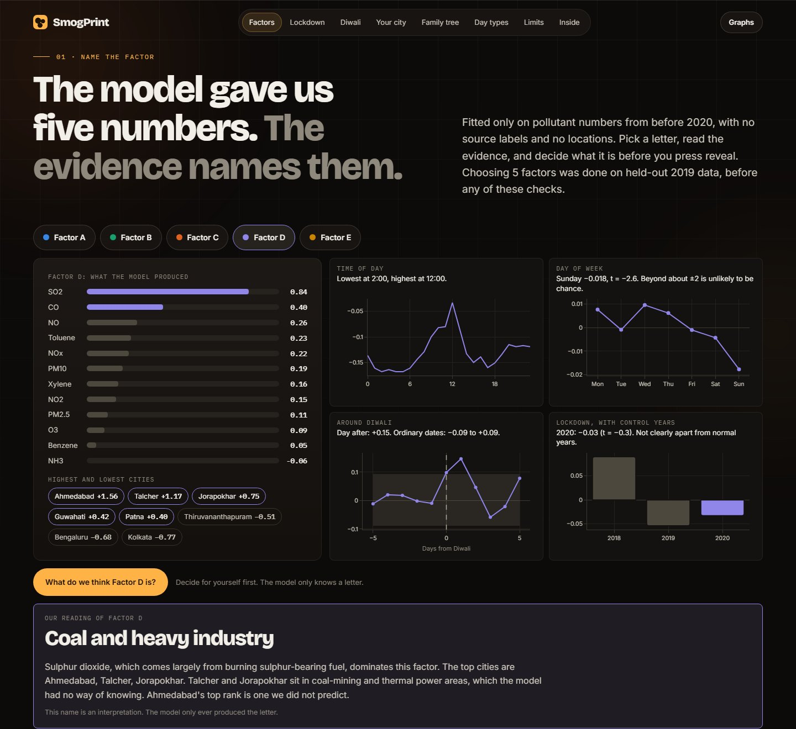

The model was told none of this. It never saw a clock, a calendar or a map while fitting. Hourly data, dates and places were only brought in afterwards, as tests.

---

<a id="tests"></a>
## 🧪 The tests it never trained on

A large change alone proves little, so every test here has a control.

### 25 March 2020: the experiment nobody planned

The model only saw data from before 2020. Then India locked down. Difference-in-differences, city by city:

```math
\text{effect} = (\text{spring} - \text{winter})_{2020} - (\text{spring} - \text{winter})_{2019}
```

| Factor | 2020 (lockdown) | t | 2019 (no lockdown) | 2018 (no lockdown) | Verdict |
|---|:---:|:---:|:---:|:---:|---|
| **A · Traffic and combustion** | **−0.46** | **−2.9** | +0.09 | +0.39 | **Clearly apart from normal years** |
| C · Dust and smoke | −0.27 | −2.3 | +0.13 | −0.24 | Not claimed: 2018 moved as much with no lockdown |
| B · Solvents and petrol vapour | −0.12 | −0.9 | +0.20 | −0.12 | No clear change |
| E · Sunlit ozone | −0.10 | −1.2 | +0.06 | −0.19 | No clear change |
| D · Coal and heavy industry | −0.03 | −0.3 | −0.05 | +0.09 | No clear change |

The evening peak of factor A (21:00) drops from +0.09 in spring 2019 to −0.61 under lockdown. One caution: the traffic factor was already lower from early March, before the lockdown began, so
the simple 2019-against-2020 picture cannot credit all of the gap to it. That is why the formal test compares each city with itself.

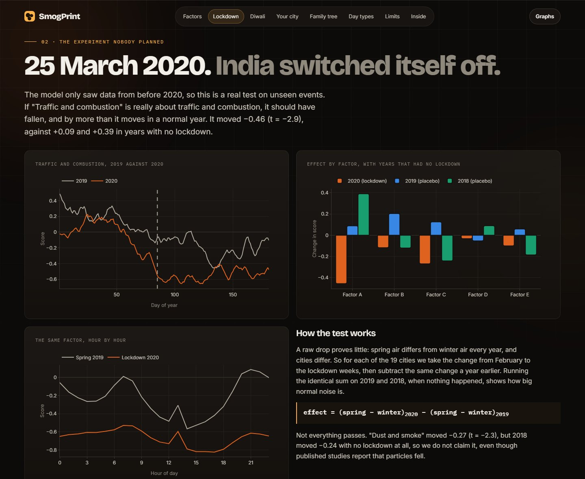

### Diwali

Dust and smoke jumps **+0.45** the day after Diwali, compared with the same city on the days either side. The same sum on 5,000 sets of ordinary October and November dates averages +0.03, and none reached it.
It is positive in **all 5 years**. The sulphur factor also rises (+0.15), which fits fireworks.

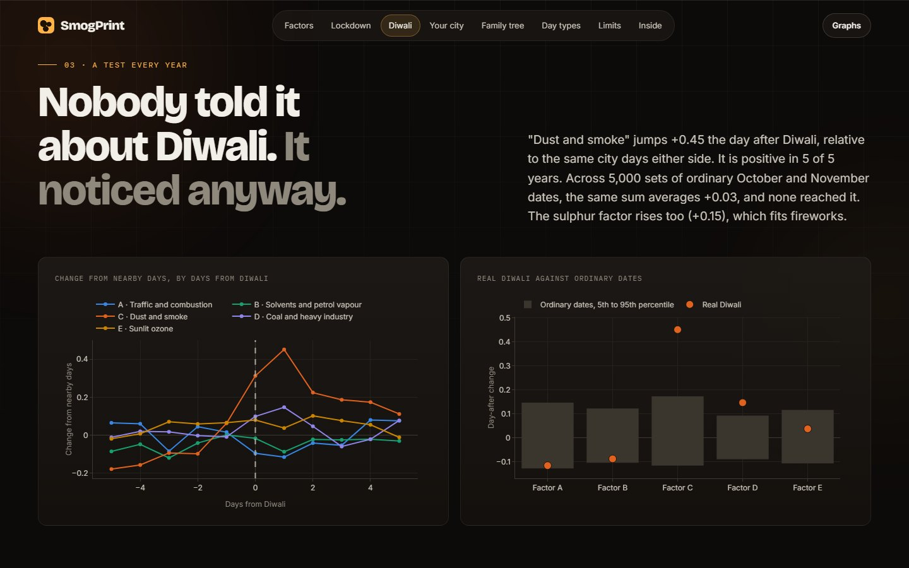

### The family tree

Hierarchical clustering sees only each city's average factor scores. Cut into four branches, one of them holds **Talcher, Jorapokhar and Brajrajnagar**:
all three coal-belt towns in the data ([1](https://www.downtoearth.org.in/news/talcher-thermal-power-plant-shuts-down-ntpc-says-modern-unit-will-replace-it-76269), [2](https://www.cerns.io/in/jharia), [3](https://en.wikipedia.org/wiki/Brajarajnagar)),
plus Guwahati, which we cannot explain.

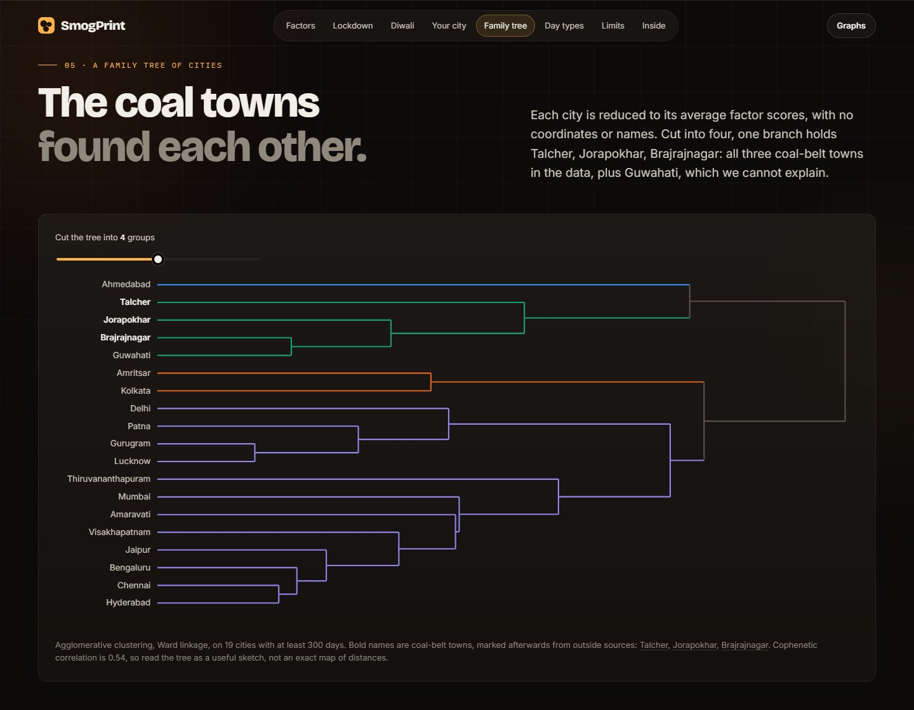

---

<a id="how"></a>
## ⚙️ How it works

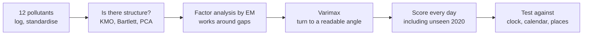

Each day's standardised pollutant vector is explained by a few hidden factors plus noise unique to each pollutant:

```math
x = W z + \varepsilon, \qquad z \sim \mathcal{N}(0, I), \qquad \varepsilon \sim \mathcal{N}(0, \Psi), \qquad \text{cov}(x) = W W^\top + \Psi
```

Monitors have large gaps (xylene is missing on 61% of days), so dropping incomplete days would waste most of the data. EM uses only the pollutants each day actually reported. For a day with observed pollutants $o$:

```math
\mathbb{E}[z \mid x_o] = \left(I + W_o^\top \Psi_o^{-1} W_o\right)^{-1} W_o^\top \Psi_o^{-1} x_o
```

Any rotation of $W$ fits exactly as well, so **varimax** picks the angle where each factor is high on a few pollutants and near zero on the rest. That is what makes the factors readable.

**How many factors?** Fit on data before 2019, then score on 2019. Gains flatten after 5, under the rule that the next factor must add at least 20% of the previous gain. No outside check played a part in this choice. Kaiser's rule and parallel analysis both say 3, and BIC keeps wanting more, so we report all of them.

---

<a id="models"></a>
## 🧮 Models

Every model is written from its equations. scikit-learn and SciPy appear only in the test suite.

| Model | Role | File |
|---|---|---|
| **PCA** | Eigen-decomposition, scree, Kaiser, parallel analysis | [`fa.py`](backend/fa.py) |
| **Factor analysis (EM)** | Finds the hidden factors, using only observed pollutants | [`fa.py`](backend/fa.py) |
| **Varimax** and **principal axis factoring** | Rotation, and a second extraction method to cross-check | [`fa.py`](backend/fa.py) |
| **K-means** | k-means++ starts, elbow, silhouette, on each day's factor scores | [`cluster.py`](backend/cluster.py) |
| **Gaussian mixture (EM)** | Soft membership of 5 day types, chosen by BIC | [`cluster.py`](backend/cluster.py) |
| **Hierarchical clustering** | Ward, average, complete and single linkage, plus a dendrogram | [`cluster.py`](backend/cluster.py) |

The outside checks are in [`evidence.py`](backend/evidence.py), and nothing there feeds back into the model.

**Data.** [Air Quality Data in India (2015 to 2020)](https://www.kaggle.com/datasets/rohanrao/air-quality-data-in-india) by Vopani on Kaggle (CC0), compiled from public Central Pollution Control Board data:
29,531 city-days and about 650,000 hourly records from 26 cities. The model is fitted on 23,095 usable days from before 2020. Everything from 2020 is unseen.

---

<a id="limits"></a>
## 🚧 What it cannot claim

| Limit | Detail |
|---|---|
| **The names are interpretation** | The model produces letters. Fitting this kind of model cannot prove what caused anything. The checks make the names plausible, not certain. |
| **Weather is in these numbers** | Midday dips partly reflect the air mixing more deeply, and winter peaks partly reflect still air. Stubble burning and winter weather both fit the northern peak, and this data cannot separate them. |
| **A claim we withdrew** | Lockdown seems to cut dust and smoke by 0.27, but 2018 moved 0.24 with nothing happening. Published studies report that particles fell, but this test does not show it. |
| **Exceptions we cannot explain** | Guwahati sits on the coal branch. Ahmedabad tops the sulphur factor. Brajrajnagar, also a coal-belt town, ranks only 9th of 19 on that factor. Raw benzene rose 51% under lockdown, which may be a data problem. |
| **Days do not form tidy clusters** | Silhouette is about 0.17, k-means and the mixture agree weakly (adjusted Rand 0.24), and 15% of days have no type above 60%. So the output is a blend, not a label. |
| **Not a substitute for a real study** | Formal source apportionment analyses particle chemistry. This is a cheap first look, in the spirit of [PCA-based receptor modelling](https://www.pubmed.gov/28455568/). |

---

<a id="screenshots"></a>
## 🖼️ Screenshots

| | |
|:---:|:---:|
| 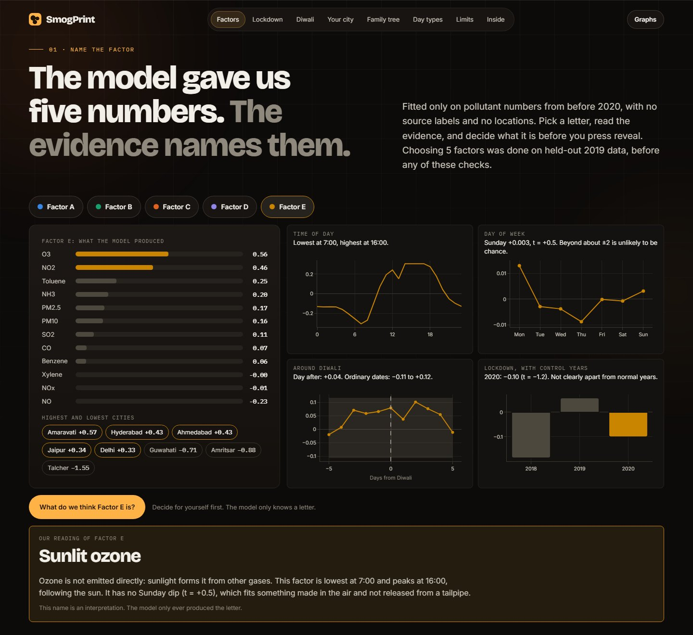<br>**Factor E: follows the sun** | 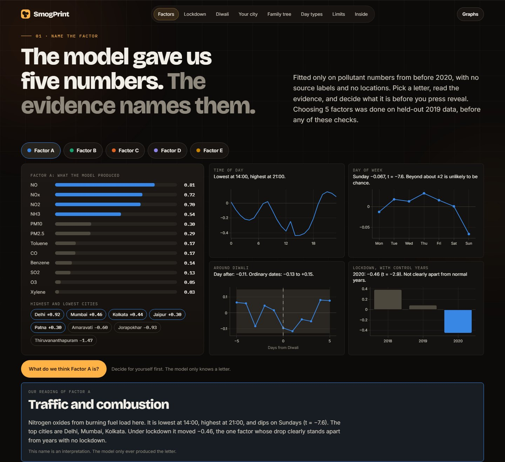<br>**Factor A: the working day** |
| 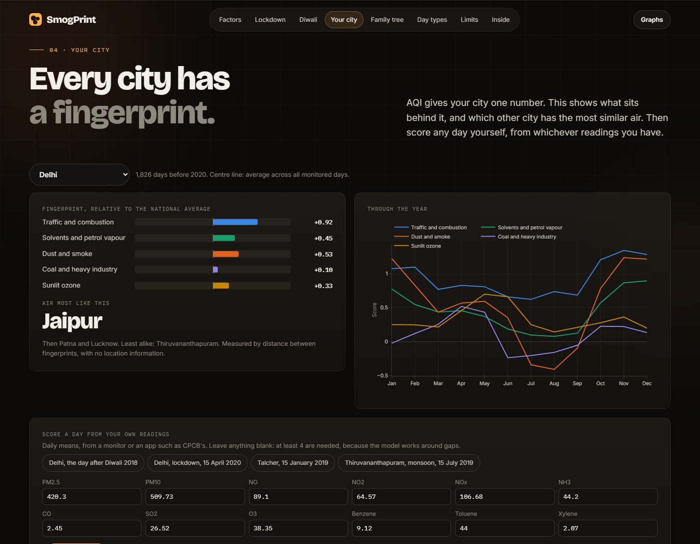<br>**Your city's fingerprint, and score any day** | 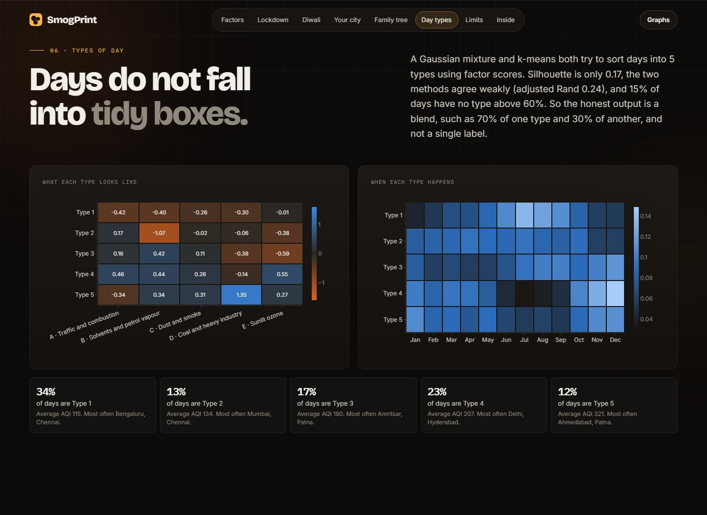<br>**Types of day, as a soft blend** |
| 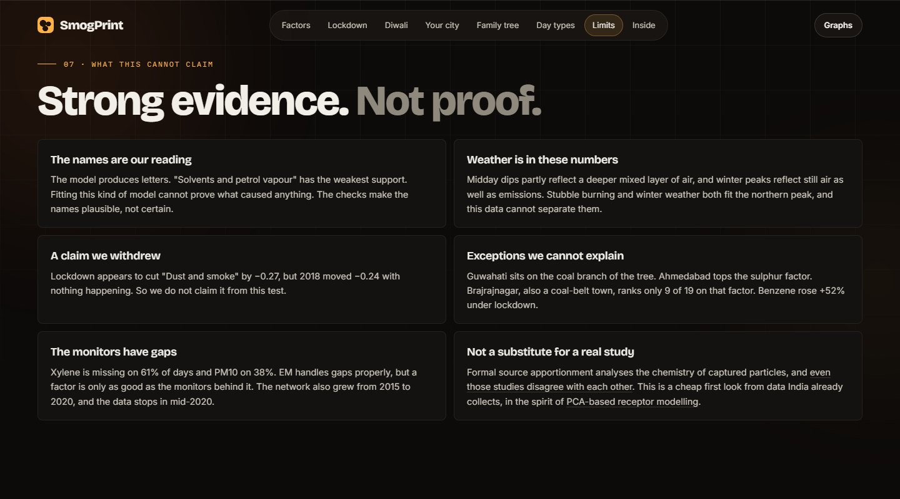<br>**What it cannot claim** | 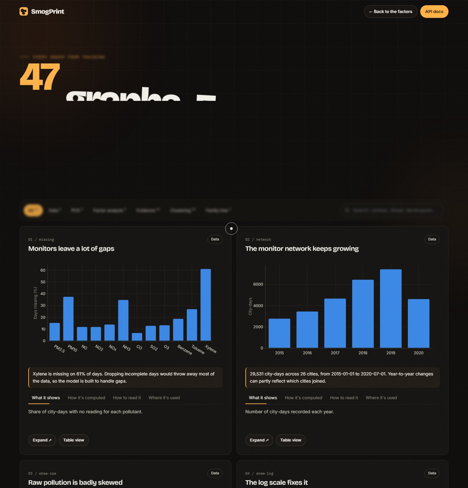<br>**47 training graphs, each explained** |

---

<a id="run"></a>
## ▶️ Run it

```bash
git clone https://github.com/krishkavin7512/SmogPrint.git
cd SmogPrint
python -m venv .venv
.venv/Scripts/activate        # on macOS or Linux: source .venv/bin/activate
pip install -r requirements.txt
python run.py                 # opens http://127.0.0.1:8003
```

Trained results are included, so it starts straight away. Useful extras:

```bash
python run.py --retrain       # retrain everything, about 40 seconds
python -m pytest tests -q     # 51 tests
```

The tests recover planted factors through missing data, check that any rotation leaves the fit unchanged, plant a known effect to confirm difference-in-differences finds it (and finds nothing when there is nothing), and compare factor analysis, varimax, k-means, the mixture, silhouette, adjusted Rand and all four linkages against scikit-learn and SciPy.

```
backend/   fa  cluster  evidence  data  train  charts  api  config
frontend/  index.html  graphs.html  assets/
artifacts/ model.json  report.json  graphs.json  scores.csv.gz
data/      city_day.csv.gz  city_hour.csv.gz
tests/     test_from_scratch.py  test_api.py
```

---

## 🗺️ Where it could go

- Add wind and temperature, to separate weather from emissions
- Non-negative matrix factorisation, the standard in formal receptor modelling, since sources cannot be negative
- Extend the data past 2020, so the lockdown is no longer the last thing it sees
- Compare factors with published chemical source studies, city by city

---

## 📄 Licence and credits

Code is under the [MIT License](LICENSE) © 2026 Kavin Krish. Data is [Air Quality Data in India](https://www.kaggle.com/datasets/rohanrao/air-quality-data-in-india) by Vopani (CC0: Public Domain), compiled from public Central Pollution Control Board data.
